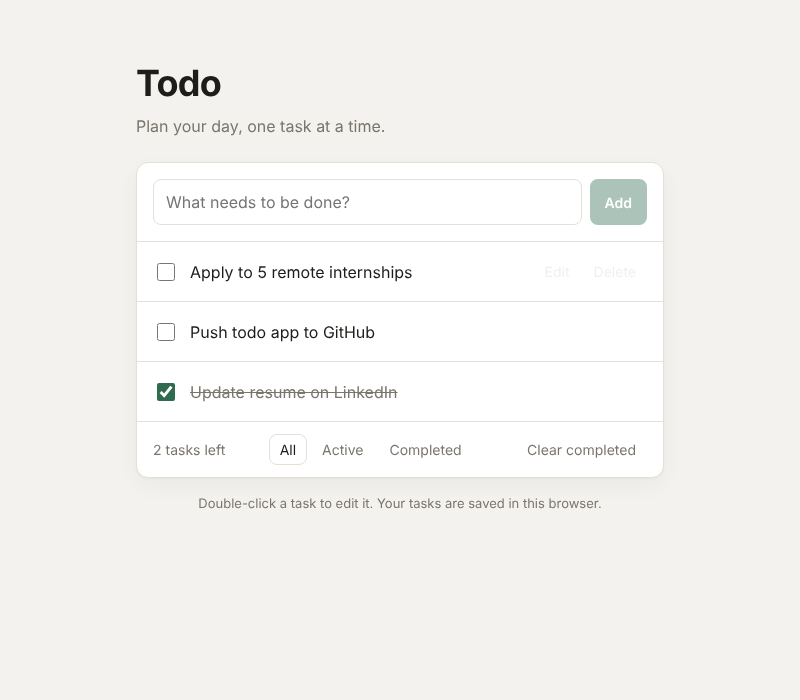

# Todo App

A clean, responsive task manager built with **React** and **Vite**. Add, edit, complete and filter tasks. Everything is saved in the browser, so your list is still there after a refresh.



**Live demo:** _coming soon (GitHub Pages)_

## Features

- Add tasks with input validation (empty input is blocked)
- Mark tasks as done or not done
- Edit a task inline: double-click it or press **Edit**, then **Enter** to save or **Esc** to cancel
- Delete single tasks or clear all completed ones at once
- Filter by **All**, **Active** and **Completed**
- Tasks persist across reloads with `localStorage`
- Light and dark mode that follows your system setting
- Keyboard and screen-reader friendly (labels, focus states, `aria-pressed` filters)
- Responsive layout that works on mobile

## Tech Stack

| Area | Tools |
| --- | --- |
| UI | React 19 (function components, hooks) |
| Build | Vite |
| Styling | Plain CSS with custom properties |
| Lint | oxlint |
| Deploy | GitHub Actions → GitHub Pages |

## Project Structure

```
src/
├── App.jsx                  # App state and task logic
├── components/
│   ├── TodoForm.jsx         # Input for new tasks
│   ├── TodoItem.jsx         # One task: toggle, inline edit, delete
│   └── FilterBar.jsx        # Counter, filters, clear completed
├── hooks/
│   └── useLocalStorage.js   # Custom hook that syncs state with localStorage
├── index.css                # Styles and light/dark theme tokens
└── main.jsx                 # Entry point
```

## What I Practiced

- Splitting the UI into small, reusable components with clear props
- Writing a custom hook (`useLocalStorage`) to separate storage logic from the UI
- Updating state immutably with functional `setState` updates
- Deriving filtered data with `useMemo` instead of storing duplicate state
- Setting up continuous deployment with GitHub Actions

## Getting Started

```bash
git clone https://github.com/<your-username>/todo-app.git
cd todo-app
npm install
npm run dev
```

Then open http://localhost:5173.

| Command | What it does |
| --- | --- |
| `npm run dev` | Start the dev server |
| `npm run build` | Build for production into `dist/` |
| `npm run preview` | Preview the production build |
| `npm run lint` | Run oxlint |

## Author

**Cho Gyeom Son** · Information and Communication Engineering, Myongji University
jgum5327@naver.com
